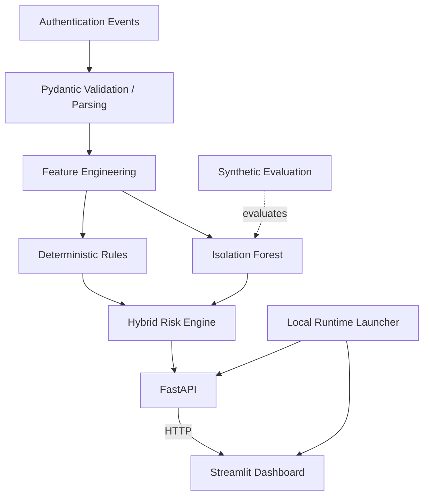

# CyberSentinel

**AI-Assisted Authentication Log Anomaly Detection**

CyberSentinel is an academic Blue Team cybersecurity prototype.

## 1. Overview

CyberSentinel analyzes authentication events to identify behavior that may warrant analyst investigation. It combines deterministic detection rules, Isolation Forest anomaly detection, explainable hybrid risk prioritization, a FastAPI service, and a Streamlit dashboard.

**An anomaly is not proof of a cyberattack.** CyberSentinel prioritizes signals for human review; it does not establish malicious intent.

## 2. Core Idea

- Rules detect patterns that are explicitly defined.
- Machine learning detects statistical deviation from learned normal behavior.
- The hybrid layer combines both signal families for analyst prioritization.

The ML output is an anomaly signal, not a certain attack detector.

## 3. Architecture



See [docs/ARCHITECTURE.md](docs/ARCHITECTURE.md) for detailed component boundaries and dependency direction.

## 4. Detection Features

- `attempts_5m`: authentication attempts for the same user within the inclusive five-minute window ending at the current event.
- `failed_attempts_5m`: failed attempts for the same user within that five-minute window.
- `unique_users_per_ip_5m`: distinct users observed from the same source IP within five minutes.
- `unique_ips_per_user_30m`: distinct source IPs observed for the same user within thirty minutes.

Features use only the current and previous chronologically ordered events; future events are not used.

## 5. Deterministic Rules

- **R001:** 5 or more failed authentication attempts within 5 minutes. Risk contribution: **40**.
- **R002:** 4 or more distinct users from the same source IP within 5 minutes. Risk contribution: **40**.

These thresholds are transparent heuristics for analyst prioritization, not proof of an attack.

## 6. Machine Learning

CyberSentinel uses an Isolation Forest baseline with the four numeric features listed above. The score convention is:

```text
anomaly_score = -decision_function
```

A higher score means behavior is relatively more atypical under the fitted model. The score is not a probability, not an attack probability, and not calibrated. In the MVP, the model is trained on synthetic normal authentication behavior.

## 7. Hybrid Risk

Signal contributions:

- R001: `+40`
- R002: `+40`
- ML anomaly: `+20`
- Maximum: `100`

Risk levels:

- `0–39`: low
- `40–59`: medium
- `60–100`: high

Confidence labels:

- no signal: low
- rules only: medium
- ML only: medium
- rules + ML: high

`risk_score` is a heuristic priority score. `confidence` describes agreement between signal families. Neither represents a probability.

## 8. Synthetic Data

The repository includes reproducible generators for:

- normal traffic;
- a failure burst against one synthetic account;
- multi-account activity from one synthetic source IP.

Generated addresses use documentation-reserved IPv4 and IPv6 ranges. No real personal authentication data is included.

## 9. Synthetic Evaluation

The current evaluation is a controlled synthetic experiment. With the audited deterministic configuration, the observed result is:

| Metric | Value |
|---|---:|
| Evaluation samples | 110 |
| Injected suspicious samples | 10 |
| Predicted anomalies | 45 |
| True positives | 10 |
| False positives | 35 |
| True negatives | 65 |
| False negatives | 0 |
| Precision | 0.2222 |
| Recall | 1.0 |
| F1 | 0.3636 |

The false-positive rate is high. These metrics describe only this synthetic experiment and do not represent expected production performance.

## 10. API

FastAPI exposes:

- `GET /health`: service and model readiness information.
- `POST /analyze`: ordered analysis of a non-empty authentication event batch.

The request payload contains an `events` list. Each authentication event has:

- `timestamp`
- `user_id`
- `source_ip`
- `result`
- `service`

For each event, `/analyze` returns the original metadata, four engineered features, risk score, risk level, confidence, reasons, deterministic rule matches, ML anomaly score, and ML anomaly boolean.

## 11. Dashboard

The Streamlit dashboard provides:

- API health checking;
- synthetic scenario selection;
- authentication event preview;
- risk summary metrics;
- an assessment table;
- explainable event details;
- deterministic rule evidence.

The dashboard does not implement detection logic itself. It communicates with FastAPI over HTTP.

## 12. Installation

Prerequisite: Python 3.11 or newer.

Windows PowerShell:

```powershell
python -m venv .venv
.\.venv\Scripts\Activate.ps1
python -m pip install --upgrade pip
python -m pip install -e ".[dev]"
```

Unix/macOS:

```bash
python3 -m venv .venv
source .venv/bin/activate
python -m pip install --upgrade pip
python -m pip install -e ".[dev]"
```

## 13. Running CyberSentinel

The recommended method starts FastAPI, waits for API readiness, and then starts Streamlit.

Windows:

```powershell
.\.venv\Scripts\python.exe -m app.runtime.demo
```

Unix/macOS:

```bash
python -m app.runtime.demo
```

Default addresses:

- FastAPI: <http://127.0.0.1:8000>
- Streamlit: <http://127.0.0.1:8501>

Ports can be changed with `--api-port` and `--dashboard-port`.

## 14. Running Components Separately

API:

```bash
python -m uvicorn app.api.main:app --host 127.0.0.1 --port 8000
```

Dashboard:

```bash
python -m streamlit run app/dashboard/main.py
```

The dashboard reads `CYBERSENTINEL_API_BASE_URL` and falls back to `http://127.0.0.1:8000`.

## 15. Testing

```bash
python -m pytest
```

The suite covers domain validation, parsing, synthetic generators, feature windows, deterministic rules, dataset conversion, Isolation Forest, synthetic evaluation, hybrid risk, FastAPI, the dashboard client, real localhost HTTP integration, and runtime process lifecycle.

At the final MVP audit, **270 tests passed**. This number may evolve as the repository changes.

## 16. Project Structure

```text
app/
  models/       Validated authentication event model
  parsing/      Raw dictionary parsing
  data/         Reproducible synthetic authentication events
  features/     Past-only temporal feature engineering
  detection/    Deterministic rules R001 and R002
  analysis/     DataFrame assembly and descriptive summaries
  ml/           Isolation Forest training and prediction
  evaluation/   Controlled synthetic ML evaluation
  risk/         Explainable hybrid risk prioritization
  api/          FastAPI schemas and endpoints
  dashboard/    Streamlit UI and HTTP client
  runtime/      Local API/dashboard process launcher
tests/          Unit and integration tests
docs/           Architecture and limitations documentation
```

## 17. Limitations

- synthetic data only;
- four engineered features;
- two deterministic rules;
- Isolation Forest baseline;
- high false-positive rate in the synthetic evaluation;
- no persistent event storage;
- no authentication or authorization;
- localhost-oriented MVP runtime;
- not production ready;
- no claim of real attack detection.

See [docs/LIMITATIONS.md](docs/LIMITATIONS.md) for the full limitations and scientific interpretation.

## 18. Security / Ethical Positioning

CyberSentinel has a defensive Blue Team scope. It uses synthetic data, contains no offensive capability or exploitation functionality, and is intended for academic learning and defensive anomaly analysis.

## 19. Technology Stack

- Python 3.11+
- Pydantic
- Pandas
- scikit-learn
- Isolation Forest
- FastAPI
- HTTPX
- Streamlit
- Uvicorn
- Pytest

## 20. Project Status

**MVP complete.**

This means the core pipeline, API, dashboard, local runtime, synthetic evaluation, and end-to-end HTTP integration are implemented and validated. It does not mean the system is production ready.
