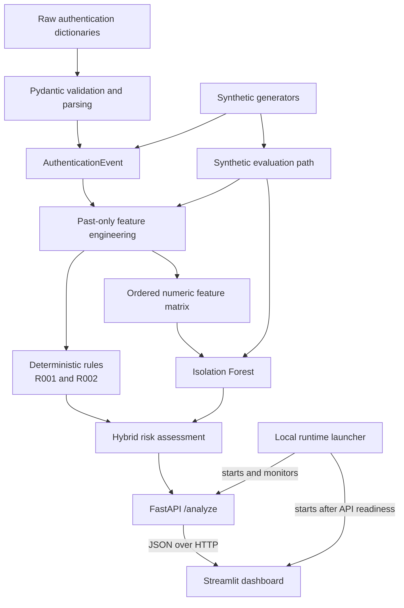

# CyberSentinel Architecture

## 1. System Context

CyberSentinel is a local academic Blue Team prototype for analyzing authentication events. It accepts validated event batches, derives temporal features, evaluates deterministic and statistical signals, and returns explainable assessments for analyst prioritization.

The externally visible processing boundary is FastAPI. The Streamlit dashboard is an HTTP consumer of that API and does not own detection logic.

## 2. Processing Pipeline



For an API request, Pydantic validates the request events, feature engineering processes them in chronological order, the fitted Isolation Forest produces anomaly signals, deterministic rules evaluate the same feature records, and the hybrid layer combines the two signal families. FastAPI serializes the resulting assessments without retraining the model.

## 3. Domain Model

`app.models.AuthenticationEvent` is the canonical event representation. It contains:

- `timestamp`: parsed as `datetime`;
- `user_id`: non-empty string with surrounding whitespace removed;
- `source_ip`: typed IPv4 or IPv6 address;
- `result`: `success` or `failure`;
- `service`: non-empty string with surrounding whitespace removed.

Extra fields are forbidden. `app.parsing` delegates raw dictionary validation directly to this model and does not duplicate its rules. Feature engineering additionally requires timezone-aware, chronologically ordered timestamps.

## 4. Synthetic Data

`app.data` supplies three reproducible inputs:

- normal authentication traffic generated from seeded cycles;
- a short failure burst for one synthetic account;
- failed multi-account activity from one synthetic IP.

Scenario timestamps are chronological. Targeted scenarios normalize their start time to UTC. Addresses come from documentation-reserved networks, and all user identifiers are synthetic.

The API also uses generated normal traffic to fit its default model once when an application instance is created.

## 5. Feature Engineering

`app.features.compute_auth_features` processes events in input order and uses only current and past events. It computes:

1. `attempts_5m`: attempts by the current user in the inclusive five-minute window;
2. `failed_attempts_5m`: failures by that user in the same window;
3. `unique_users_per_ip_5m`: distinct users for the current source IP in five minutes;
4. `unique_ips_per_user_30m`: distinct source IPs for the current user in thirty minutes.

Deque-backed histories discard events older than each cutoff. Events exactly on a cutoff remain included. Non-chronological or timezone-naive input is rejected.

`app.analysis` converts feature records to inspectable Pandas DataFrames, extracts the ordered numeric matrix, and provides basic descriptive summaries. `FEATURE_COLUMNS` defines the shared ML feature order.

## 6. Deterministic Detection

`app.detection` contains two transparent heuristics:

- **R001:** at least five failed attempts for one user within five minutes;
- **R002:** at least four distinct users from one source IP within five minutes.

Each match contains a rule identifier, severity, description, timestamp, and evidence. When both rules trigger, their stable order is R001 followed by R002. The rules describe observable patterns and do not confirm malicious intent.

## 7. ML Detection

`app.ml` trains a scikit-learn `IsolationForest` on the four ordered numeric features. The default configuration uses 100 estimators, `contamination="auto"`, and `random_state=42`.

Predictions preserve feature-record identity and order. The public score convention is:

```text
anomaly_score = -decision_function
```

Higher values are relatively more atypical under the fitted model. This value is neither calibrated nor probabilistic. A non-fitted model is handled through sklearn's standard `NotFittedError` behavior.

## 8. Hybrid Risk Assessment

`app.risk` centralizes the combination of deterministic and ML signals:

- R001 contributes 40;
- R002 contributes 40;
- an ML anomaly contributes 20;
- the total is capped at 100.

Risk levels are low from 0 to 39, medium from 40 to 59, and high from 60 to 100. Confidence is low with no signal, medium with rules only or ML only, and high when rules and ML agree.

Prediction and feature records must align by object identity. Reasons are generated in deterministic rule order followed by the ML reason. The anomaly-score magnitude is preserved for inspection but does not alter the risk score.

## 9. API Layer

`app.api` owns externally exposed orchestration.

- `GET /health` reports service identity, prototype status, and model readiness.
- `POST /analyze` accepts a non-empty ordered event list.

The application fits its default Isolation Forest once when `create_app` is called without an injected model. Requests reuse that fitted model. The analyze endpoint validates events, computes features, invokes the hybrid analysis, and serializes one ordered response assessment per event.

Feature errors such as non-chronological input become HTTP 422 responses. There is no persistence layer.

## 10. Dashboard Layer

`app.dashboard` is a presentation and HTTP-client layer. It provides synthetic scenario selection, event preview, API health checking, summary metrics, an assessment table, reasons, and deterministic rule evidence.

The required direction is:

```text
dashboard -> HTTP -> API
```

It is deliberately not:

```text
dashboard -> feature/rule/ML/risk business logic
```

The only local domain use is serialization of `AuthenticationEvent` objects and creation of synthetic demonstration events. Detection results come from FastAPI. Locally created HTTP clients use a ten-second timeout and are closed by the client layer; caller-injected clients remain caller-owned.

## 11. Runtime Layer

`app.runtime.demo` starts the MVP using the current Python interpreter:

1. validate hosts and ports;
2. start Uvicorn/FastAPI;
3. poll `/health` for at most 15 seconds;
4. start Streamlit only after the API reports readiness;
5. pass `CYBERSENTINEL_API_BASE_URL` to the dashboard;
6. supervise both processes;
7. stop the dashboard and then the API on interruption or failure.

Cleanup first requests termination, waits, and falls back to kill if necessary. The runtime manages processes only; it does not perform detection.

## 12. Evaluation Path

`app.evaluation` builds labeled samples from synthetic normal, failure-burst, and multi-account scenarios. Labels describe scenario origin rather than confirmed attacks.

It validates sample/prediction alignment and calculates TP, FP, TN, FN, precision, recall, and F1 with zero-division handling. Training records are supplied separately; the audited experiment trains on generated normal feature records.

This path is independent of API request processing and exists to inspect the behavior of the synthetic ML baseline.

## 13. Dependency Direction

The principal in-process dependency direction is:

```text
models
├── parsing
├── data
└── features
    ├── analysis
    │   └── ml
    └── detection
        └── risk (also depends on ml)

evaluation -> data + features + ml
api        -> data + features + ml + risk
dashboard  -> models + synthetic demo data + remote API over HTTP
runtime    -> subprocess management + HTTP readiness
```

There are no reverse imports from foundational layers into API, dashboard, or runtime code, and no circular application dependencies.

## 14. Design Decisions

- **Rules and ML are separated:** explicit heuristics remain independently inspectable from statistical deviation.
- **The hybrid layer centralizes risk:** scoring, confidence, and explanation logic have one owner.
- **The API owns exposed orchestration:** external consumers receive one validated and serialized contract.
- **The dashboard remains presentation-only:** it cannot diverge by reimplementing detection.
- **The runtime only manages processes:** startup, readiness, environment propagation, and cleanup stay outside business logic.
- **Synthetic inputs are explicit:** the MVP can be reproduced without personal authentication data.
- **Identity alignment is strict:** predictions cannot silently attach to a different feature record.
- **Scientific meaning is constrained:** anomaly scores, risk, and confidence are never treated as attack probabilities.
